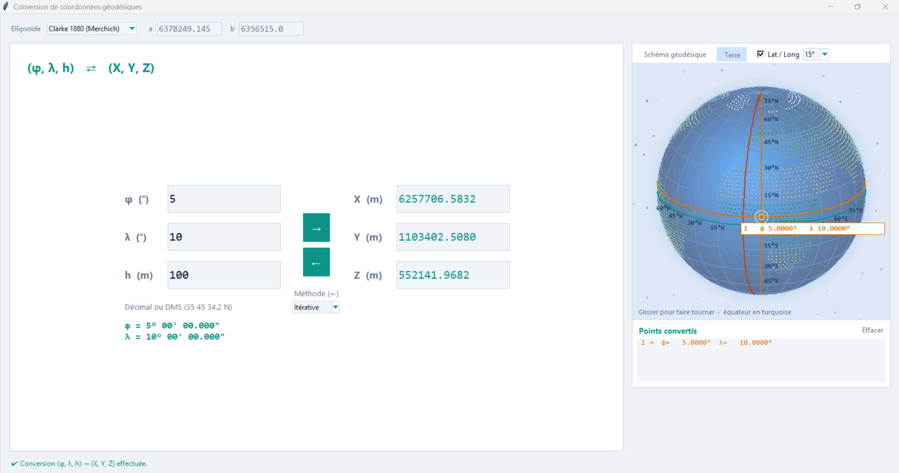
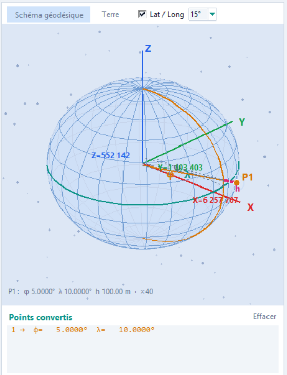
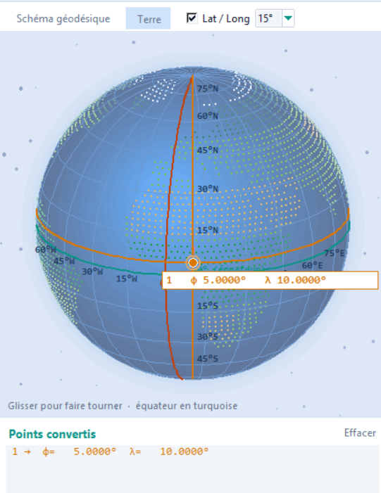

# Conversion de coordonnées géodésiques ⇄ cartésiennes

Petit programme Python (tkinter) qui convertit une position entre deux écritures, dans les deux sens, et la dessine sur un schéma 3D et sur un globe.

| Écriture | Ce que c'est |
|---|---|
| **φ, λ, h** (géodésique) | latitude, longitude, hauteur au-dessus de l'ellipsoïde |
| **X, Y, Z** (cartésienne) | la même position, en mètres, à partir du centre de la Terre |

- **→** convertit (φ, λ, h) en (X, Y, Z)
- **←** convertit (X, Y, Z) en (φ, λ, h)

Chaque conversion ajoute un point sur le globe, qu'on peut faire tourner à la souris.

## Utilisation

1. Choisir l'ellipsoïde en haut (Clarke 1880 par défaut, celui du système Merchich au Maroc). Avec « Personnalisé », on tape soi-même `a` et `b`.
2. Remplir un côté de la carte, puis cliquer sur la flèche qui va vers l'autre côté (ou appuyer sur Entrée).
3. Les angles se tapent en degrés décimaux  ou en degrés-minutes-secondes .
4. Pour ←, choisir la méthode **Directe** ou **Itérative** (même résultat, deux façons d'y arriver).
5. Le panneau de droite propose deux vues : **Schéma géodésique** et **Terre**. Cliquer sur une ligne de la liste tourne la vue vers ce point.


## Démonstration

### Exemple chiffré

Point de départ : un point de Marrakech, ellipsoïde **Clarke 1880 (Merchich)**.

| Champ | Valeur saisie |
|---|---|
| φ | `31 37 48 N` (soit 31.6300°) |
| λ | `8 00 32 W` (soit -8.0089°) |
| h | `466` m |

En cliquant sur **→**, le programme donne :

| X (m) | Y (m) | Z (m) |
|---|---|---|
| 5383237.9777 | -757416.4307 | 3325556.2688 |

En remettant ces X, Y, Z et en cliquant sur **←**, on retrouve le point de départ, avec les deux méthodes :

| Méthode | φ (°) | λ (°) | h (m) |
|---|---|---|---|
| Directe | 31.630000000 | -8.008888888 | 466.0000 |
| Itérative | 31.630000000 | -8.008888888 | 466.0000 |

Le dernier chiffre de λ (…888 au lieu de …889) vient de l'arrondi de X, Y, Z à 4 décimales dans la fenêtre : l'écart (1e-9°) représente environ 0,1 mm au sol.

Avec le même point sur l'ellipsoïde **WGS 84**, le résultat change un peu, car l'ellipsoïde n'est pas le même :
X = 5383062.4353 m, Y = -757391.7321 m, Z = 3325813.0586 m.

### Captures de l'interface

Les trois captures ci-dessous utilisent le même exemple, dans le sens **←** : on saisit les coordonnées cartésiennes d'un point de Marrakech (Maroc), avec l'ellipsoïde **Clarke 1880 (Merchich)** et la méthode **Itérative**.

| Champ saisi | Valeur |
|---|---|
| X (m) | `5383237.9777` |
| Y (m) | `-757416.4307` |
| Z (m) | `3325556.2688` |

Le programme en déduit :

| φ (°) | λ (°) | h (m) |
|---|---|---|
| 31.630000000 (soit 31° 37' 48.000" Nord) | -8.008888888 (soit 8° 00' 32.000" Ouest) | 466.0000 |

En sens inverse, avec `31 37 48 N`, `8 00 32 W` et `466` puis la flèche **→**, on retrouve ces mêmes X, Y, Z.

#### Fenêtre complète : conversion à gauche, globe à droite

Au centre de la carte de conversion, on saisit X, Y et Z (colonne de droite), puis la flèche **←** remplit φ, λ et h (colonne de gauche) : ici φ = 31.630000000°, λ = -8.008888888° et h = 466.0000 m. Les résultats calculés s'affichent en couleur d'accent pour les distinguer des valeurs tapées. Les angles sont rappelés en degrés-minutes-secondes sous les champs, et la ligne verte en bas confirme que la conversion a réussi. Le choix de la méthode (directe ou itérative) se trouve sous les flèches et concerne la conversion **←**. À droite, le panneau du globe et la liste des points convertis (la ligne commence par ← puisque la conversion est partie de X, Y, Z).

<p align="center">
  
</p>

#### Vue « Schéma géodésique » : normale, angles φ et λ, hauteur h, axes X Y Z

Cette vue montre l'ellipsoïde (aplatissement exagéré ×40, seul le dessin l'est) avec les axes X, Y, Z. Pour le point P1, on voit le méridien du point, l'arc de la longitude λ sur l'équateur, la normale à la surface avec l'arc de la latitude φ, et la hauteur h en rose entre la surface et P1. Comme le point est dans l'hémisphère nord, il se trouve au-dessus du plan de l'équateur : sa coordonnée Z est positive (Z = 3 325 556 m), de même que X (X = 5 383 238 m), alors que Y est négatif (Y = -757 416 m) car le point est à l'ouest de Greenwich. Les pointillés montrent comment lire X, Y et Z, dont les valeurs sont écrites sur les axes. Le petit texte en bas rappelle les valeurs exactes du point.

<p align="center">
  
</p>

#### Vue « Terre » : globe coloré avec les points convertis

Le globe est formé de points colorés selon le type de terrain (glace, désert, forêt, plaines), sur un océan en dégradé. Le quadrillage (ici tous les 15°) se règle avec la case « Lat / Long ». L'équateur est en turquoise et le méridien de Greenwich en orange. Le point P1 (φ = 31.6300°, λ = -8.0089°) est marqué par un disque qui pulse, avec son méridien, son parallèle et une étiquette de coordonnées. Il tombe au Maroc, dans l'hémisphère nord, juste à l'ouest du méridien de Greenwich. On fait tourner le globe en glissant la souris, et un clic sur la liste « Points convertis » ramène la vue vers le point choisi.

<p align="center">
  
</p>

## Tests unitaires

Les tests sont dans la partie 5 du fichier `conversion_geodesique.py`. Ils utilisent le module `unittest` de Python.


### Validation avec le point Merchich

Le test principal utilise le point Merchich, sur l'ellipsoïde **Clarke 1880** (a = 6378249.145 m, b = 6356515.0 m).

| Donnée | Valeur |
|---|---|
| Latitude φ | 33°26'59".672 Nord (soit 33.449908889°) |
| Longitude λ | 7°33'27".295 Ouest (soit -7.557581944°) |
| Hauteur h | 243.419 m au sol, 243.730 m au sommet du pilier |

Coordonnées cartésiennes de référence, obtenues avec la conversion directe :

| Position | X (m) | Y (m) | Z (m) |
|---|---|---|---|
| Sol (h = 243.419) | 5281240.0238 | -700688.7667 | 3495569.8454 |
| Sommet du pilier (h = 243.730) | 5281240.2810 | -700688.8009 | 3495570.0169 |

Les écarts acceptés sont de 0,1 mm sur X, Y, Z et h, et de 1e-9° sur les angles (environ 0,1 mm au sol).

### Ce que les tests vérifient

| Classe de tests | Contenu |
|---|---|
| `TestPointMerchich` | conversion → vers les X, Y, Z de référence ; conversion ← (méthodes directe et itérative) vers φ, λ, h ; aller-retour complet ; accord des deux formules de h (`h = √(X²+Y²)/cos φ − N` et `h = Z/sin φ − N(1 − e²)`) ; écart de 0,311 m entre le sol et le pilier ; accord des deux méthodes |
| `TestSaisieAngles` | lecture de `33 26 59.672 N` et `7 33 27.295 W`, formats `W` et `O`, virgule décimale, sud négatif, saisie illisible, `dms` et `parse_angle` inverses l'un de l'autre |
| `TestCasGeneraux` | aller-retour sur 6 points et les 4 ellipsoïdes, équateur et pôle nord, excentricité de Clarke 1880 |

### Tester à la main dans l'interface

Avec l'ellipsoïde **Clarke 1880 (Merchich)**, saisir `33 26 59.672 N`, `7 33 27.295 W` et `243.419`, puis cliquer sur **→** : on doit lire X = 5281240.0238, Y = -700688.7667 et Z = 3495569.8454. En remettant ces valeurs et en cliquant sur **←**, on retrouve φ = 33.449908889°, λ = -7.557581944° et h = 243.4190 m.

## Les principes du calcul

### 1. L'ellipsoïde

La Terre est un peu aplatie aux pôles. On la modélise par un ellipsoïde de demi-grand axe `a` (équateur) et de demi-petit axe `b` (pôles) :

```text
e² = (a² − b²) / a²                 excentricité au carré (0 = sphère parfaite)
N  = a / √(1 − e² · sin²φ)          rayon de courbure du premier vertical
```

`N` est la distance entre un point de la surface et l'axe des pôles, mesurée le long de la verticale du lieu.

### 2. Conversion → : (φ, λ, h) vers (X, Y, Z)

Formule directe, sans boucle :

```text
X = (N + h) · cos φ · cos λ
Y = (N + h) · cos φ · sin λ
Z = (N · (1 − e²) + h) · sin φ
```

### 3. Conversion ← : (X, Y, Z) vers (φ, λ, h)

La longitude est simple : `λ = atan2(Y, X)`. La difficulté est que φ et h dépendent l'un de l'autre. Deux solutions sont proposées.

**Méthode directe (formule fermée)**, avec `p = √(X² + Y²)`, `r = √(X² + Y² + Z²)` et `f = (a − b) / a` :

```text
µ = atan( Z/p · ((1 − f) + a·e²/r) )
φ = atan( (Z·(1 − f) + e²·a·sin³µ) / ((1 − f) · (p − e²·a·cos³µ)) )
h = p·cos φ + Z·sin φ − a·√(1 − e²·sin²φ)
```

**Méthode itérative** : on part d'une latitude approchée `φ = atan2(Z, p)`, puis on répète jusqu'à stabilisation (4 ou 5 tours suffisent). On s'arrête lorsque `|φᵢ − φᵢ₋₁|` est inférieur à la précision demandée :

```text
φ = atan( (Z/p) / (1 − e²·N / (N + h)) )
N = a / √(1 − e²·sin²φ)
h = p / cos φ − N
```

### 4. Cas particulier

Si `X = Y = 0`, le point est exactement sur l'axe des pôles et la longitude n'a plus de sens. Le programme refuse ce cas avec un message.

## Les principes de l'affichage

- **Radians en interne, degrés à l'écran.** Les formules utilisent des radians, l'utilisateur voit des degrés.
- **Schéma géodésique.** Pour un point P, il montre l'ellipsoïde, les axes X Y Z, la normale, les angles φ et λ, la hauteur h et les projections de P sur les axes. L'aplatissement est exagéré ×40 pour être visible. Seul le dessin est exagéré, les nombres affichés sont exacts.
- **Point intéressant du schéma.** La normale ne passe pas par le centre de la Terre : elle coupe l'axe des pôles à `z = −N·e²·sin φ`, et c'est de ce point que φ est mesurée. La latitude géocentrique ψ (angle du rayon du centre à P) est un peu différente de φ.
- **Globe 3D.** Les continents sont des contours simplifiés, transformés en points régulièrement espacés. Chaque point est tourné, incliné, puis projeté à l'écran. La profondeur dit s'il est devant ou derrière.
- **Animation.** Une boucle (environ 30 images par seconde) met à jour la rotation et redessine tout.
- **Couleurs.** Cinq thèmes (`sombre`, `clair`, `foret`, `violet`, `chaud`) donnent une couleur à chaque élément. L'océan est en dégradé, les continents sont colorés par type de terrain (glace, désert, forêt...).

## Organisation du code

Le fichier `conversion_geodesique.py` est commenté pas à pas et se lit de haut en bas :

| Partie | Contenu |
|---|---|
| 1. Les calculs | ellipsoïdes, `e2_of`, `N_of`, `geo_to_cart`, `cart_to_geo_directe`, `cart_to_geo_iterative`, `parse_angle`, `dms` |
| 2. Le globe | contours des continents, `_inside`, `land_cat`, `build_land_dots` |
| 3. Les couleurs | thèmes, `blend`, couleurs des continents et de l'océan |
| 4. La fenêtre | classe `App` : interface, logique (`to_xyz`, `to_geo`), dessin (`draw_schema`, `draw_terre`), animation (`tick`) |
| 5. Les tests | tests unitaires `unittest` validés avec le point Merchich (`TestPointMerchich`, `TestSaisieAngles`, `TestCasGeneraux`) |
